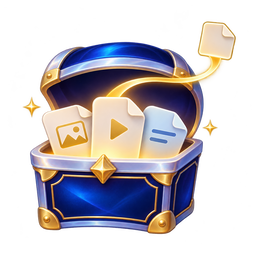
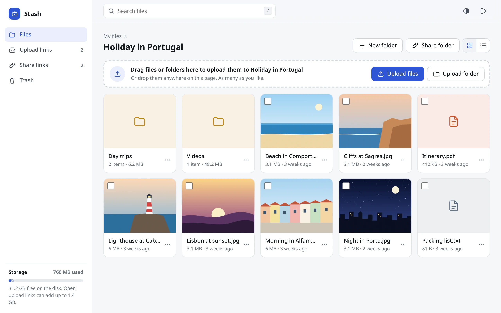
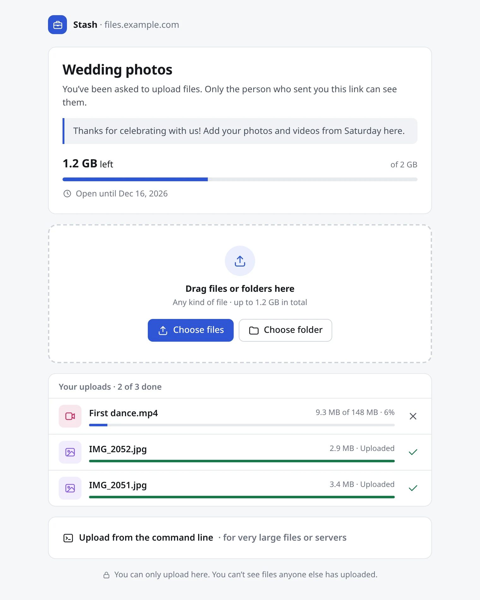

<div align="center">



# Stash

A place for your files that you run yourself, with links that let other people send you files or
download the ones you pick, and see nothing else.

[](https://github.com/dvdstelt/stash/releases)
[](https://hub.docker.com/r/dvdstelt/stash)
[](https://github.com/dvdstelt/stash/actions/workflows/test.yml)
[](LICENSE)

<picture>
  <source media="(prefers-color-scheme: dark)" srcset="docs/images/screenshot-files-dark.webp">
  
</picture>

<p>
  <a href="#what-is-stash">What is Stash</a> &bull;
  <a href="#features">Features</a> &bull;
  <a href="#how-to-use">How to use</a> &bull;
  <a href="#quick-start-docker">Quick start</a> &bull;
  <a href="#help-and-community">Help</a> &bull;
  <a href="#license-and-attribution">License</a>
</p>

</div>

## What is Stash

Stash is a place for your files that runs on your own computer or NAS. Besides keeping your own
files, it does two things that are awkward with the usual cloud services:

- **Collecting files.** Need photos from a party, or a database backup from a customer? Send an
  upload link. People add files up to the link's size limit, from the browser or the command line,
  and see nothing else: not your files, and not what anyone else sent.
- **Sending files.** Pick some files, or a whole folder, and send a share link. People view and
  download only that, one by one or as one zip file.

The people you send links to don't need an account. Your files stay on your machine, in one folder
that's easy to back up. Stash is one small program for one owner, with one password.

## Features

**Your files**

- Upload files and whole folders, with their subfolders, by dragging them onto the page or picking
  them. Every file gets its own progress bar, and a dropped connection only costs a moment.
- Look at photos, PDFs, videos and text files right in the browser.
- Folders, search, renaming, and a menu on every file and folder.
- Tick files with a click, Ctrl+click, Shift+click or Ctrl+A, and share or delete them together.
- Deleted files and folders stay in the trash for 30 days, so a wrong click can be undone.

**Upload links: ask people for files**

- Every link has its own size limit, from 25 MB for a few photos to 500 GB for a backup, plus an
  optional maximum number of files, expiry date, password and message.
- People can upload a whole folder, and every file in it counts towards the link's limits.
- Very large files go up from the command line, with ready-made commands for curl, wget and
  PowerShell on macOS, Linux and Windows.
- A QR code opens the link on a phone, or goes on a printed sign at an event.

**Share links: send people files**

- Share some files, or a whole folder with its subfolders. A shared folder includes files you add
  to it later.
- People see previews, and download one file at a time or everything as a zip that keeps the
  folders.
- Links can expire, stop after a number of downloads and have a password. A download that breaks
  off can be resumed.

**Safe by design**

- Files from strangers never run in your browser: web pages, SVG images and anything else that could
  contain code are always downloaded, and so are PDFs that came through an upload link.
- Password guessing is slowed down, and every wrong password is logged, so fail2ban can block it.
- Password-protected links show nothing but their name until the password is right.
- One Go program without dependencies, in an image of about 8 MB for Intel, AMD and ARM, including
  the Raspberry Pi.

<p align="center">
  <picture>
    <source media="(prefers-color-scheme: dark)" srcset="docs/images/screenshot-upload-link-dark.webp">
    
  </picture>
  <br>
  <sub>What someone sees when they open an upload link.</sub>
</p>

## How to use

1. **Start Stash** with the [quick start](#quick-start-docker) below, and choose your password.
2. **Add your files.** Drag files or folders onto the page, or click **Upload files** or
   **Upload folder**.
3. **Ask someone for files.** Go to **Upload links**, click **New upload link**, choose a size limit
   and send the link. What they send arrives in **My files › Requests**.
4. **Send someone files.** Tick the files and click **Create share link**, or open a folder and
   click **Share folder**. Then send the link.

The full documentation:

- **[Using Stash](docs/using.md):** everything you can do with your files, upload links and share
  links, and the command line.
- **[Installing Stash](docs/installing.md):** keeping your files in a folder you choose, backups,
  updates, starting Stash automatically, and making your links work outside your home.
- **[Technical guide](docs/technical.md):** HTTPS and reverse proxies, fail2ban, all settings, the
  security model, the HTTP interface, and building Stash yourself.

## Quick start (Docker)

You need Docker or Podman. With Podman, type `podman` instead of `docker`.

```bash
docker run -d --name stash -p 8080:8080 -v stash-data:/data docker.io/dvdstelt/stash
```

Stash now runs on port 8080 and keeps everything in the `stash-data` volume. To choose your
password, show its log:

```bash
docker logs stash
```

Open the link in the line `No password is set yet. Choose one here: …` and choose a password of at
least 10 characters. Only someone who can read Stash's log can use that link, and it works once.
From then on, open http://localhost:8080 and sign in.

To put Stash on the internet, start it automatically or keep your files in a folder of your own,
see the [installation guide](docs/installing.md).

## Help and community

- **Questions, ideas and bugs:** [open an issue](https://github.com/dvdstelt/stash/issues/new), or
  [look through the open ones](https://github.com/dvdstelt/stash/issues) first.
- **Security problems:** please don't describe them in a public issue. Open an issue that only says
  you found one, and we'll find a private way to share the details.
- **New versions:** see the [changelog](CHANGELOG.md) for what each version brings, and the
  [releases](https://github.com/dvdstelt/stash/releases). Every release is on
  [Docker Hub](https://hub.docker.com/r/dvdstelt/stash) as `docker.io/dvdstelt/stash`.
- **Contributing:** contributions are welcome. The [technical guide](docs/technical.md#development)
  explains how to build, run and test Stash, and [AGENTS.md](AGENTS.md) lists the conventions and
  the security rules that changes must keep.

## License and attribution

Stash is open source under the [Apache License 2.0](LICENSE). You may use, change and share it, also
commercially and in your own fork, as long as you keep the copyright notice and the
[NOTICE](NOTICE) file and mark the files you changed. Contributions are accepted under the same
license.

Stash is made by Dennis van der Stelt and contributors. It's written in [Go](https://go.dev) and
uses no other libraries. The program includes Go's runtime and standard library, copyright The Go
Authors, under Go's [BSD-style license](https://go.dev/LICENSE).
