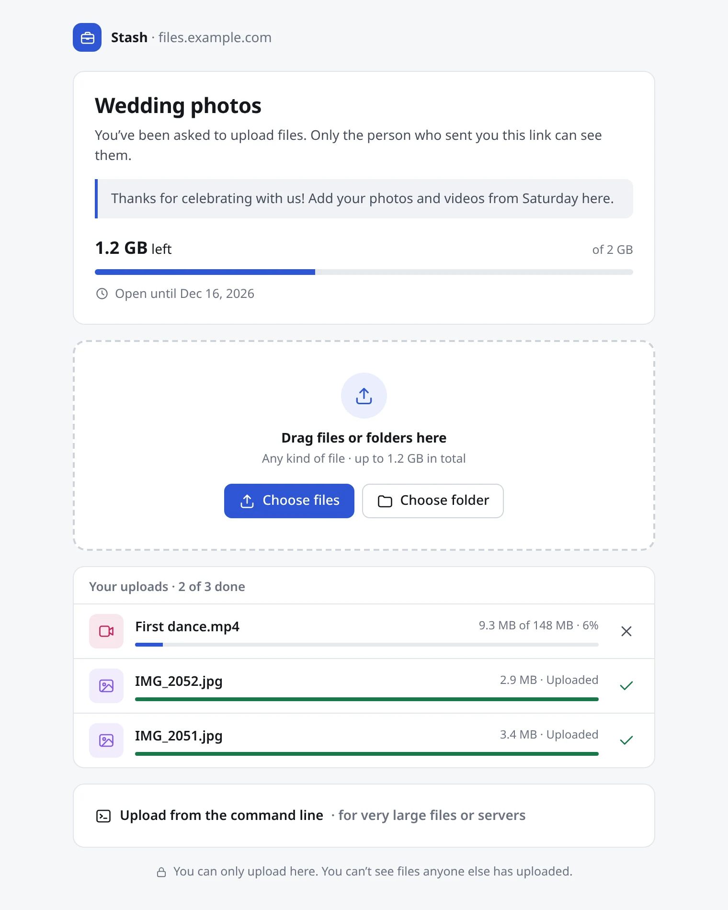

# Using Stash

How to keep your files in Stash, ask people for files and send files to them. To install Stash first,
see the [installation guide](installing.md).

## Your files

- Drag files onto the page, or click **Upload files**. Every file gets its own progress bar, and
  you can keep working while they upload.
- Folders work the same way: drag them onto the page, or click **Upload folder**. The folders inside
  come along. If a folder with the same name is already there, the files are added to it. Empty
  folders are left out.
- Click **New folder** to make a folder.
- Click a file to see it, download it, share it or delete it.
- Tick files to share or delete several at once, with their checkbox or by Ctrl+clicking them
  (Cmd+click on a Mac). Shift+click ticks every file from the one you ticked last up to that one.
- To tick every file in a folder, press Ctrl+A (Cmd+A on a Mac), tick the box at the top of the
  list, or click **Select all** in the bar that appears once you tick a file. Files in the folders
  inside aren't ticked. In search results, it ticks every file found.
- Every file and folder has a **⋯** button with everything you can do with it. Right-clicking a
  file or folder shows the same menu.
- Deleting a file or folder moves it to the **Trash**. You can restore it from there for 30 days;
  after that, it's deleted for good. **Empty trash** deletes everything in it right away.
- Use the search box at the top to find files. Pressing `/` jumps to it.

## What's new

After an update, Stash opens a window with what the new version brings, the first time you open it.
Click **Got it** when you've read it, and it won't open by itself again until the next update. Click
**Remind me later** to see it again next time.

The version number at the bottom of the menu shows which version is running. Click it to read
what's new again, also for earlier versions. A dot next to it means there's news you haven't seen.

## Asking someone for files: upload links

1. Go to **Upload links** and click **New upload link**.
2. Give it a name, which they'll see as the title of the page, and choose a size limit. If you
   like, set an expiry date, a maximum number of files, a password and a message.
3. Copy the link and send it. Or click **Show QR code**: a phone's camera opens the link from the code,
   and you can download the code to print it, for example on a sign at an event.

The person who opens the link sees your message, how much space is left, and an area to drag files
or folders onto. They can't see files that are already there. If the link is full, has expired or
was revoked, they get a clear message instead. A folder they upload arrives with the folders inside
it, and every file in it counts towards the link's limits.

  <picture>
    <source media="(prefers-color-scheme: dark)" srcset="images/screenshot-upload-link-dark.webp">
    
  </picture>

Files arrive in **My files › Requests**, in a folder named after the link. Renaming that folder
renames the link too, and deleting it revokes the link. You can change a link's limits, revoke it or
reopen it at any time.

## Sending someone files: share links

1. Tick the files you want to send and click **Create share link**. Or go to **Share links** and
   click **New share link**. To send a whole folder, open it and click **Share folder**, or choose
   **Share folder…** from its **⋯** menu.
2. Give it a name and, if you like, an expiry date, a download limit, a password and a message.
3. Copy the link and send it, or click **Show QR code** to open it on a phone or print it.

They see the files with previews, and can download them one by one or all together as a zip file.
A file you delete disappears from the link, and comes back if you restore it from the trash.

A shared folder includes the folders inside it. The page shows each of them under its own heading,
and the zip file keeps them as folders. Files you add to the folder later show up on the link too.
**My files** itself can't be shared as a whole, because that would include what people send you
through upload links.

## Very large files: the command line

For huge files, a browser isn't always practical. Every upload link shows ready-made commands that
work in a terminal. They look like this:

| On | Command |
|---|---|
| macOS, Linux | `curl -T ./backup.zip https://files.example.com/d/LINK-CODE/` |
| Windows 10 and later | `curl.exe -T .\backup.zip https://files.example.com/d/LINK-CODE/` |
| PowerShell 7 | `Invoke-RestMethod -Method Put -InFile .\backup.zip -Uri https://files.example.com/d/LINK-CODE/backup.zip` |

- If the link has a password, add `-H "Link-Password: YOUR-PASSWORD"` to the curl command, or
  `-Headers @{ 'Link-Password' = 'YOUR-PASSWORD' }` to the PowerShell one.
- For very large files on Windows, use `curl.exe`. Older Windows PowerShell (5.1) loads the whole
  file into memory first.
- Share links work the same way: `curl -L -o files.zip https://files.example.com/s/LINK-CODE/all.zip`
  downloads everything.
